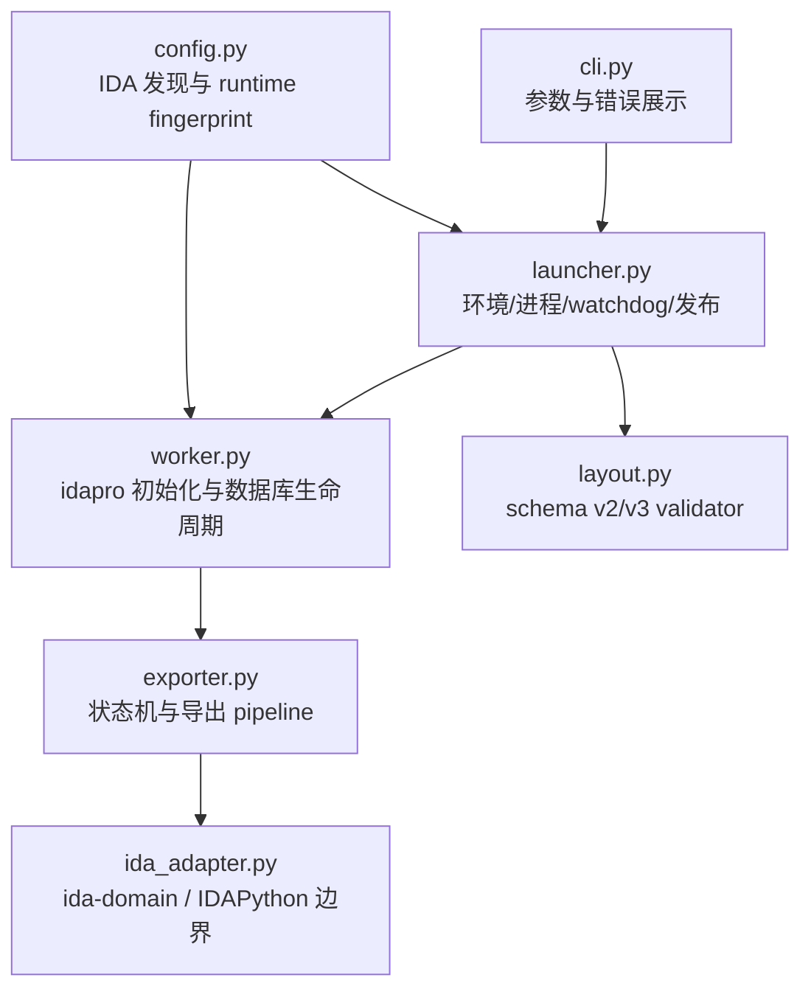
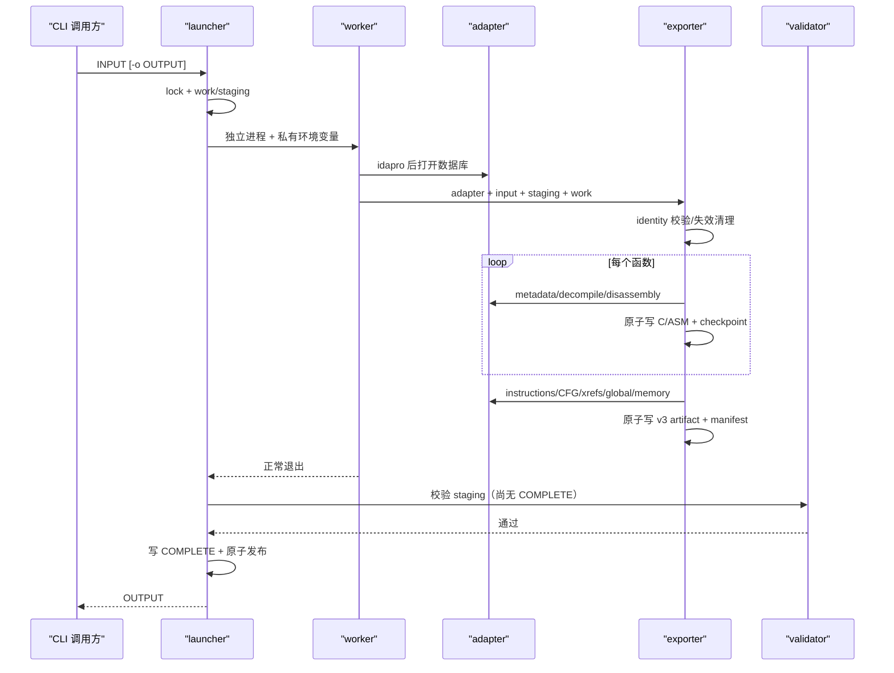

# IDA Export CLI 架构优化与功能完善方案

## 1. 当前结论

P0/P2 已经从规划进入实现：项目发布 schema v3，具备阶段化恢复、runtime identity、原子 artifact、heartbeat/watchdog、流式 validator，以及 instructions/xrefs/CFG/string refs/names/data/comments/types。

当前架构的正确方向是保留一个小型 launcher 和一个 IDA worker，把所有 IDA 访问压在 `ida_adapter.py` 边界内。现阶段继续保留 `exporter.py` 单文件；优化应以内部区块、上下文对象和清晰依赖方向为主，不拆成大量琐碎模块。

固定约束：

- `idalib` 是唯一默认后端；
- `ida-domain` 优先；直接 IDAPython 仅补缺口；
- CLI 只有 `INPUT [-o OUTPUT]`；
- 单样本单 worker；
- 发布结果必须经过 validator；
- 目录扫描、多 IDA 并发和 I/O worker pool延期。

## 2. 文件与依赖架构



### 2.1 `cli.py`

职责：

- 接受输入路径和可选 `-o`；
- 调用 `launcher.run()`；
- 将明确的异常转为命令行退出状态。

保持项：不加入架构、loader、并发、超时、范围过滤和导出类别开关。策略继续由内部版本化常量控制，避免 CLI 与恢复 identity 组合爆炸。

### 2.2 `config.py`

职责：

- 发现 `IDADIR`、官方激活配置和常见路径；
- 返回 idapro Python 路径；
- 收集 IDA/ida-domain 版本提示；
- 对 runtime、capability 和 policy 生成稳定 fingerprint。

边界：只处理环境和普通 Python 值，不导入会初始化 IDA 内核的模块。

### 2.3 `launcher.py`

职责：

- 输入/输出路径检查和 job ID；
- 同一输入的进程级互斥；
- 创建 work/staging、环境变量和 worker 进程组；
- 读取 heartbeat，执行 stall/hard watchdog；
- 信号转发、TERM/KILL、worker 回收；
- 复制最终 `task.log`；
- 调用 `validate_export(require_complete=False)`；
- 写 `COMPLETE`、原子发布和成功清理。

边界：不导入 IDA Python API，不读取分析语义，不自行修改 manifest。

### 2.4 `worker.py`

职责：

- 文件首部先导入 `idapro`；
- 在单进程主线程打开 `IdaDomainAdapter`；
- 组合 launcher 版本提示与 adapter capability；
- 生成包含 runtime/capability/policy fingerprint 的 identity；
- 驱动 `export_snapshot()` 并关闭数据库；
- 将 worker 级失败写入 heartbeat 和 `task.log`。

边界：不定义 artifact 路径、JSON 字段和恢复策略。

### 2.5 `ida_adapter.py`

职责：

- 优先使用 ida-domain 访问 database/functions/pseudocode/instructions/xrefs/flowchart/strings/names/bytes/comments/types；
- 对 ida-domain 0.5.x 缺少或行为不同的接口进行 capability-guarded IDAPython fallback；
- 在本文件内消费所有 SWIG/IDA 对象；
- 向 exporter 返回字符串、整数、布尔、列表、字典和 iterator；
- 局部读取失败写入 DTO 的 `read_error`，不扩大成整样本失败；
- 提供 `release_decompiler_cache()`。

直接 IDA API 的新增规则：

1. 先检查 ida-domain 是否有等价能力；
2. fallback 封装为私有 helper；
3. 在 helper 内把 enum 同时转为可读名称和 raw value；
4. 返回前移除 SWIG 对象；
5. 为缺失 API、未知 enum 和迭代中途异常增加单元测试。

### 2.6 `exporter.py`

当前单文件建议稳定为以下区块：

```text
1. 常量、Protocol 和通用 hash/atomic writer
2. _ExportState：identity/journal/marker/blacklist/stage/memory
3. 名称、header、JSONL、hexdump 工具
4. memory 与 pointer 辅助
5. P2 function：instructions/CFG/xrefs/call sites
6. P2 global：string_xrefs/names/data/comments/types
7. export_snapshot：函数 -> P2 -> global -> memory -> manifest
```

继续控制 `export_snapshot()` 的职责：它负责顺序和共享统计，不承载每种 DTO 的 IDA 访问细节。新增 helper 以“完整阶段”为单位，避免拆成只有一两行的包装函数。

建议下一次内部整理引入一个私有 `_ExportContext` dataclass，但仍留在本文件：

```python
@dataclass
class _ExportContext:
    adapter: AnalysisAdapter
    input_path: Path
    output: Path
    writer: _ArtifactWriter
    state: _ExportState
    heartbeat: Callable[..., None]
    started_at: datetime
```

它用于减少 `adapter/state/writer/output/heartbeat` 的参数重复，不成为公共 API，也不改变文件数量。

### 2.7 `layout.py`

职责：

- 接受 schema v2/v3；
- 流式读取 JSONL并保留物理行号；
- 校验必需文件、JSON 类型、counts、函数 EA、callgraph 对齐；
- 校验安全相对路径、artifact 唯一性和 hash；
- 校验 instructions/CFG/xrefs 和 P2 全局文件；
- 校验 pointer、segment、memory；
- 增量计算 artifact inventory hash；
- 按 `require_complete` 检查 `COMPLETE` 与 schema 一致。

边界：不尝试修复快照，不依赖 IDA，不将所有 JSONL 物化到内存。

## 3. 运行时数据流



所有心跳都通过 work 目录的原子 JSON 文件传递，不借用 stdout 内容判断进度。stdout/stderr 合并进入 `task.log` 只用于人类诊断。

## 4. 恢复状态模型

### 4.1 identity 层

identity 判断旧工作状态是否属于同一分析语义。键包含输入 SHA-256、schema、generator、runtime、capability 和 policy fingerprint。

匹配：允许复用已完成函数、阶段和 memory chunk。  
失配：旧 `identity.json` 保存为 `identity.previous.json`，清空 state，并清理 exporter 所有权的 snapshot 产物；保留日志、锁和非工具文件。

identity 变化是全局失效；未来函数 content hash 是局部失效，二者应分层实现。

### 4.2 函数层

```text
metadata -> decompile -> disassembly -> artifact_write -> completion
```

只有 decompile 中断进入 blacklist。completion 至少绑定：函数 EA/end EA、C/ASM 路径和 hash。恢复时任一条件不满足就 invalidate，重新生成并请求 `NO_CACHE`。

P2 instructions/CFG 当前在函数主产物完成后统一导出，并发送逐函数 heartbeat。下一阶段若要实现 P2 单函数复用，应把四类 artifact 纳入同一 content fingerprint，而不是增加第二套独立 blacklist。

### 4.3 阶段与 memory 层

`progress.jsonl` 记录 `complete/invalidate/stage/memory_chunk` 事件，`progress.json` 是可重建的 compact cache。

全局 JSON/JSONL 阶段用阶段状态和 artifact 存在性复用；memory 以 chunk key、范围、原始 hash 和文本 hash 复用。P2 全局阶段和每个 memory chunk都会刷新 heartbeat。

### 4.4 发布层

manifest 的 `status=complete` 表示 worker 已完成内容生成；它仍不是发布承诺。只有 launcher 复制最终日志、validator 通过并写入 `COMPLETE` 后，目录才是可消费快照。

## 5. schema v3 架构

### 5.1 文本证据和结构证据并存

| 证据 | 用途 |
|---|---|
| `.c` | 语义检索和快速理解 |
| `.asm` | 验证反编译、寄存器、调用约定和精确控制流 |
| instructions JSONL | 地址、bytes、mnemonic、operands、comment 的程序化处理 |
| CFG JSON | 基本块边、循环、分支和可达性分析 |

这四类文件都由 `function_index.jsonl` 引用并带 hash，互不替代。

### 5.2 关系分层

- `callers/callees`：函数级依赖；
- `call_sites`：调用发生的具体地址；
- `xrefs.jsonl`：调用、跳转、数据等有意义地址关系；
- CFG：普通顺序控制流和基本块边；
- `pointers.jsonl`：data xref 与裸指针扫描证据；
- `string_xrefs.jsonl`：字符串与引用位置的专用索引。

`ORDINARY_FLOW` 已从全局 xref 过滤，避免与 CFG 重复并显著膨胀输出。

### 5.3 capability 和 runtime

`capabilities` 表示 exporter 能生成的 v3 类别；`runtime` 表示实际 adapter/IDA/ida-domain feature flags 和 decompilation flags。两者必须区分：方法存在不代表底层版本拥有完整实现，局部缺口通过空记录或 `read_error` 表达。

## 6. 下一阶段架构优化

### 6.1 P3-A：DTO 和稳定错误码

当前 adapter 已返回普通 dict，但字段拼写依赖隐式约定。建议在 `ida_adapter.py` 与 `exporter.py` 的边界引入少量内部 dataclass 或 TypedDict：

```python
class InstructionDto(TypedDict):
    ea: str | None
    size: int
    bytes: str | None
    mnemonic: str | None
    operands: list[str]
    text: str | None
    regular_comment: str | None
    repeatable_comment: str | None
    read_error: str | None
```

只为 instructions、xref、CFG block、artifact ref 和 error 建模，不为每个 JSON 文件建立独立类层次。错误增加稳定 `code`，同时保留 `message`：

```text
DECOMPILE_ERROR
DISASSEMBLY_ERROR
IDA_API_ERROR
ARTIFACT_IO_ERROR
UNKNOWN_ENUM_VALUE
PARTIAL_ITERATION
```

### 6.2 P3-B：函数 content hash

在 adapter 中生成 fingerprint input，在 exporter state 中比较：

```text
bytes + range + name + signature + flags + comments + policy
```

命中时复用四类函数 artifact；变化时重做函数。callgraph/xrefs 采用独立 relation hash，避免函数关系变化导致无条件重新 decompile。

最终索引写入后，扫描 `functions/`、`instructions/`、`cfg/`，删除没有引用的 artifact。此清理只处理 exporter 所有权目录。

### 6.3 P3-C：memory/pointer

- adapter 返回 initialized/file-backed/zero-fill 信息；
- exporter 跳过或压缩明确的稀疏区间，并在 index 中保留范围；
- chunk key 加 segment identity；
- pointer 增加大小、字节序、策略和置信度；
- 单条读取异常进入 warnings JSONL 和 manifest count。

### 6.4 P3-D：跨文件 validator

在保持单遍/有限集合的条件下增加：

- CFG instruction EA 与对应 instructions 对齐；
- call site 与 xref 对齐；
- P2 全局记录的 function EA 存在性；
- artifact inventory 中没有未索引的函数产物；
- capability、必需文件和 counts 三者一致。

对超大样本，允许保存 EA/hash 集合，但不保存整行 JSON 对象。

### 6.5 P4：离线消费层

建立独立只读 query 包或命令，按地址、名称、xref、调用深度和全文搜索快照。SQLite/FTS 是可重建 cache；JSON/JSONL 仍是 source of truth。归档也在发布完成后执行，不延长 IDA 数据库生命周期。

## 7. 性能策略

当前已采用：

- 每 250 函数清理 Hex-Rays cache；
- JSONL 流式 validator；
- inventory 增量 hash；
- 1 MiB memory chunk；
- 函数/P2/global/memory heartbeat；
- `duration_ms/decompile_duration_ms/slow` 指标。

继续优化前先记录基线：总时间、函数阶段时间、memory 时间、峰值 RSS、artifact 数、work journal 大小。纯 I/O worker pool保持延期，因为当前瓶颈更可能是 IDA API、Hex-Rays 和全局遍历；引入线程前必须证明写盘占比足够高，并保证线程只接收 immutable DTO/bytes。

## 8. 测试与验收门槛

### 8.1 每次修改的基础门槛

- 单元测试全部通过；
- `compileall` 通过；
- schema v2 fixture 仍可验证；
- schema v3 fixture 的必需文件、counts、hash、inventory 和 `COMPLETE` 通过；
- CLI help 仍只显示 INPUT 和 `-o`。

### 8.2 真实样本

- Mach-O：本地测试目录使用无头文件最小 fixture，可通过 `IDA_EXPORT_TEST_SOURCE` 增加外部样例；
- PE64：`ReadDex.exe` 作为 1218 函数回归；
- 后续增加 ELF、分支/循环 CFG、thunk、间接调用、大 BSS 和稀疏 segment。

### 8.3 故障注入

- 四个函数阶段分别中断，验证 blacklist 语义；
- P2 global、memory chunk、manifest 前中断并恢复；
- heartbeat 不变化触发 stall；
- SIGINT/SIGTERM 后进程组消失；
- identity 任一 fingerprint 变化后无旧 artifact；
- journal 尾部截断、artifact 截断、路径穿越、重复 EA/xref 被拒绝；
- 输入在分析期间变化时不发布。

## 9. 实施顺序

| 顺序 | 工作 | 主要文件 | 验收 |
|---|---|---|---|
| 1 | DTO/错误码与 `_ExportContext` | `ida_adapter.py`、`exporter.py` | 不改变公开 schema，测试覆盖局部错误 |
| 2 | memory/pointer 治理 | `ida_adapter.py`、`exporter.py`、`layout.py` | 大 BSS/稀疏段有确定结果和性能基线 |
| 3 | content/relation hash | `ida_adapter.py`、`exporter.py` | 变化函数局部重做，无孤儿 artifact |
| 4 | 跨文件一致性 | `layout.py` | CFG/instruction/call-site/P2 引用一致 |
| 5 | 离线 query/FTS | 新的独立只读入口 | 不打开 IDA，不修改快照 |
| 6 | ZIP/diff | 独立发布后工具 | 解压后可重新验证，diff 可追溯到 EA/hash |

## 10. 核心工具不纳入项

- 目录递归扫描；
- 多个 IDA 实例并发；
- 当前阶段的 I/O worker pool；
- 常驻 RPC/MCP 服务；
- GUI timer、插件菜单和弹窗；
- 把 BinExport、SQLite 或 ZIP 作为唯一输出；
- 从伪 C 反向推导 CFG、types 或 xrefs。

这些能力会增加状态、许可证、线程和发布组合复杂度，且不服务当前“一次命令分析一个样本”的核心目标。
